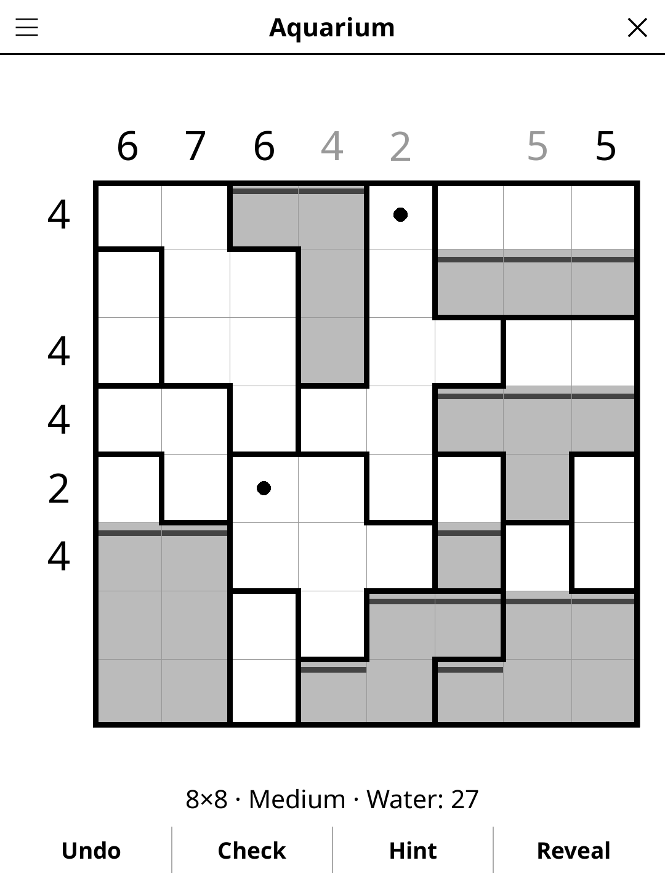

# aquarium.koplugin

An Aquarium logic puzzle for [KOReader](https://github.com/koreader/koreader).

## Screenshot

## Rules

The grid is divided into tanks by thick walls. Fill some cells with water:

1. Water obeys gravity: inside a tank the surface is level. If a cell is
   filled, every cell of the same tank on that row and on every row below it
   is filled too.
2. A tank may be full, partly filled or empty.
3. The number next to each row and above each column says how many of its
   cells hold water. A blank clue gives no information.

## Features

- **Grid sizes** — 6×6, 8×8, 10×10
- **Three difficulty levels**, graded by the reasoning needed, not by guesswork:
  - *Easy* — every clue shown, solvable line by line from simple bounds
    ("even with every other tank empty this row is short, so this tank must
    fill").
  - *Medium* — a few clues hidden; needs exact counting along a line (which
    combinations of tank levels make the row add up).
  - *Hard* — smaller tanks and many more clues hidden, still solved by line
    reasoning alone: no level ever needs "what if" trial and error.
- **Unique solution, proven** — the generator's solver deduces every tank's
  level from the clues before a puzzle is shown.
- **Gravity built in** — a tap moves a whole water level, so the grid never
  shows floating water.
- **Live clues** — a clue turns grey once its line holds exactly that much
  water, and white on black when it holds too much.
- **Hint** — two taps: the first says which cell is about to give, the second
  fills it (or drains a wrong one).
- **Check**, **Reveal**, **Undo**, timer, and auto-save.

## Controls

| Action | How |
|--------|-----|
| Fill a tank up to a row | Tap a dry cell |
| Drain a tank below a row | Tap a wet cell |
| Mark a cell as staying dry | Long-press a dry cell (a dot) |
| Undo / Check / Hint / Reveal | Buttons under the board |
| New game, size, difficulty, rules | Title-bar menu |

## Why e-ink friendly?

Two flat tones (white, grey water) and thick black walls; no animation; each
move repaints the board once.

## License

GPL-3.0
